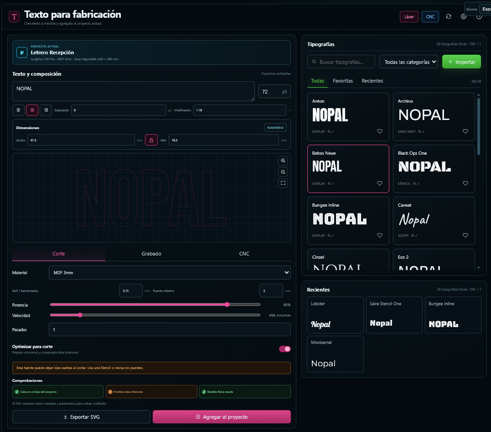

# Texto para fabricación (plugin de NOPAL)

Plugin independiente para crear texto con medidas físicas y devolverlo como un elemento editable al proyecto actual de NOPAL. La biblioteca de 20 tipografías es el selector interno del editor.



## Características

- 20 familias incluidas localmente; funciona sin conexión después de instalarse.
- Licencia SIL Open Font License 1.1 incluida junto a cada tipografía.
- Cobertura comprobada para español, inglés, alemán, francés y portugués de Brasil.
- Vista previa, favoritos, recientes, filtros e importación local de TTF/OTF.
- Conversión real de glifos a elementos `<path>` mediante `opentype.js`.
- Ancho y alto exactos en milímetros, proporción bloqueable, espaciado, interlineado y alineación.
- Lienzo físico interactivo: arrastre para posicionar, controlador de esquina para redimensionar y zoom con la rueda del mouse.
- Cuatro puntos de redimensionamiento y controlador de arco estilo LightBurn: mantén `Ctrl` para mostrar el punto azul del lado izquierdo y arrástralo verticalmente.
- Dos estilos de contorno: **Sólido**, con grosor configurable en milímetros, y **Línea**, como trazo fino puro. Ambos se conservan en el SVG y en los metadatos del proyecto.
- Parámetros de material, kerf/herramienta, puente mínimo, potencia, velocidad y pasadas.
- Validaciones de área disponible, posibles islas interiores y detalles demasiado pequeños.
- Acción principal **Agregar al proyecto**, que entrega SVG, posición, dimensiones, operación y datos editables mediante `NopalProject.addElement()` o el evento `nopal:add-project-element`.
- Exportación SVG, guardado en Biblioteca y envío opcional a la cola de producción.

## Momento de uso

Desde un proyecto NOPAL, el usuario elige **Agregar elemento → Texto para fabricación**. El plugin recibe máquina, material y área disponible; al terminar, devuelve el texto como una capa del proyecto. El SVG incluye metadatos para recuperar texto, fuente y ajustes tipográficos.

## Desarrollo

```bash
python -m unittest discover -s tests -v
node --check frontend/font-library.js
python -m http.server 8766
```

Después abre `http://127.0.0.1:8766/tests/harness.html`.

## Estructura

```text
nopal-plugin.json
frontend/
  font-library.js
  font-library.css
  vendor/opentype.min.js
fonts/
  catalog.json
  <familia>/<archivo>.ttf
  <familia>/OFL.txt
tests/
```

Este repositorio es el paquete completo del plugin. NOPAL lo instalará clonándolo en `plugins/font-library/`; no requiere cambios dentro del núcleo de NOPAL.
